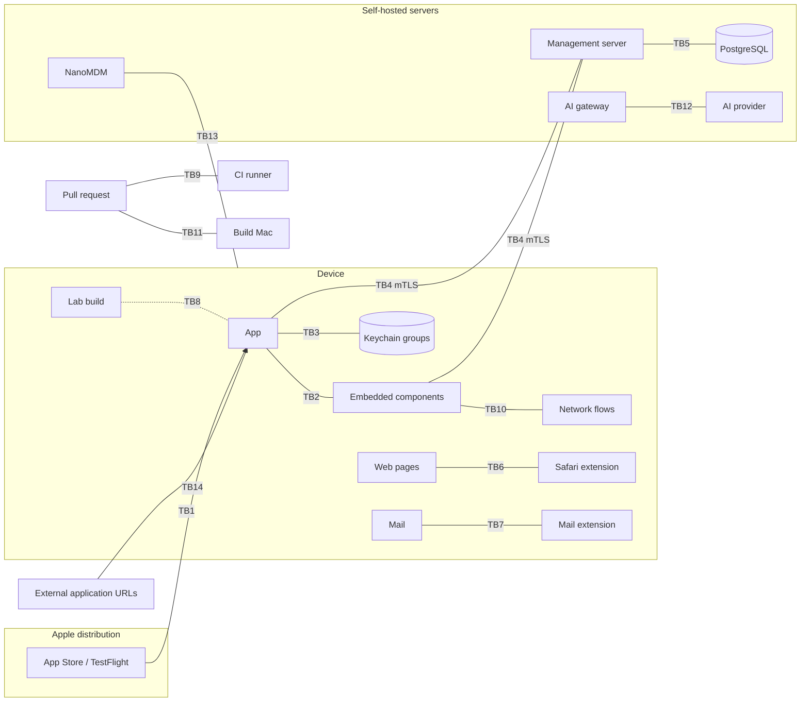

# Threat model

Initial threat model of WardAxis (PRE-008, #8). It fixes the scope, the assets, the attackers and the trust boundaries. Each ADR cites a boundary by its `TB` ID and lists its own threats. The full STRIDE analysis, abuse cases and residual risks come with roadmap 6.3, when the components have real logic.

Update this file in the same change as a new trust boundary, a new asset or a new out-of-scope decision. Write new ADRs from [adr/TEMPLATE.md](adr/TEMPLATE.md).

## Scope

### In scope

| Component | Distribution | Record |
|---|---|---|
| WardAxis app (macOS, iOS/iPadOS, tvOS) | App Store | [ADR 0010](adr/0010-app-store-only-distribution.md) |
| Eight embedded components: three macOS system extensions, URL filter, packet tunnel, Safari Web Extension, Mail extension, login item agent | Embedded in the app | [ADR 0008](adr/0008-extensions-under-app-store.md), [ADR 0005](adr/0005-extension-shells.md) |
| Management server and its contract (configuration feed, mTLS) | Self-hosted, Docker | [ADR 0001](adr/0001-swift-server-stack.md) |
| AI gateway and DLP engine: receives content from explicitly integrated clients and forwards it to the configured AI provider | Self-hosted, Phase 4 | Planned: roadmap ADR-009; boundary TB12 |
| NanoMDM server and its MDM and APNs credentials | Self-hosted, Phase 5 | Planned: roadmap ADR-010; boundary TB13 |
| Build, signing and CI pipeline, including the build Mac | Repository, local gate, GitHub Actions | [ADR 0002](adr/0002-app-store-signing-identifiers.md), [ADR 0007](adr/0007-pull-request-ci.md) |
| Lab build, only as a risk to the shipped build | Internal, never published | [ADR 0003](adr/0003-lab-build-signing.md), [ADR 0009](adr/0009-endpoint-security-lab-only.md) |

### Out of scope

| Item | Reason |
|---|---|
| EndpointSecurity, root daemons, privileged helpers and setuid binaries in a shipped build | Guideline 2.4.5(i), (v); [ADR 0009](adr/0009-endpoint-security-lab-only.md) |
| TLS interception of third-party traffic | Only in the isolated, owned test laboratory (roadmap Architecture) |
| MDM features or configuration profiles inside the app | Guideline 5.5; the separate NanoMDM server delivers profiles |
| Downloaded or updatable code, a custom updater | Guideline 2.4.5(iv), (vii); [ADR 0010](adr/0010-app-store-only-distribution.md) D3 |
| Sending matched content to a cloud classifier | Classification is on-device; telemetry is opt-in and carries no matched content |
| The internals of the configured AI provider | A third party. What the gateway sends to it is in scope (TB12) |
| Apple services: App Store, TestFlight, Apple Business Manager, APNs, notarization | Trusted (see Attackers and assumptions) |
| watchOS and visionOS | No target |
| Jailbroken devices, SIP disabled, a compromised kernel | The platform protections are the base of every boundary below |
| A local administrator who wants to remove WardAxis | The user owns the device and can remove the app or its extensions. Removal resistance is an MDM matter (Phase 5) |
| Physical attacks and forensic recovery from a locked device | Covered by Data Protection and the Keychain accessibility class, not by WardAxis |

## Assets

| ID | Asset | Where | Protection |
|---|---|---|---|
| A1 | Device client identity (mTLS key and certificate) and enrollment token | Keychain, shared group | Data protection keychain, `AfterFirstUnlockThisDeviceOnly`, not synchronizable ([ARCHITECTURE.md](ARCHITECTURE.md#secure-storage)) |
| A2 | Configuration and policy | Today: the configuration cache `<Application Support>/<bundle ID>/Configuration/configuration.json` in the app's own container (`Caches` on tvOS). Planned: policy snapshots in the App Group container and in each enforcement component | Cache: Data Protection `completeUntilFirstUserAuthentication`, excluded from backup, envelope typed and size-bounded at decode. The configuration values are schemaless JSON (`ConfigurationValue`), bounded in size and nesting depth only; a consumer reads them as typed schema documents ([ADR 0011](adr/0011-versioned-schemas.md)). Not protected against an unsandboxed process of the same user (TM2) |
| A3 | Event outbox and logs | Today: unified log, and the log file `Library/Logs/<bundle ID>/log.log` in the app's own container. Planned: event outbox in the App Group container | Privacy labels; no matched content, credentials or PII ([LOGGING.md](LOGGING.md)) |
| A4 | Integrity of enforcement: the decision a filter or extension makes | NE providers, Safari and Mail extensions | Fail-closed shells (ADR 0005 D2); semantics per roadmap ADR-012 |
| A5 | Signing identities and profiles | Build Mac keychain, Apple Developer account | Never in the repository or CI ([ADR 0007](adr/0007-pull-request-ci.md) D1). Exposed to any code that the build Mac runs (TB11) |
| A6 | Server TLS private key and device CA | Server host: the key at `TLS_PRIVATE_KEY_PATH` (unencrypted PEM) with its chain at `TLS_CERTIFICATE_CHAIN_PATH`; only the public device-CA certificates at `TLS_CLIENT_CA_PATH` | Outside the repository; file permissions on the host ([Server/README.md](../Server/README.md)). The device-CA private key is never on the server host |
| A7 | Health-check probe identity | Server host or container: `HEALTHCHECK_CLIENT_CERTIFICATE_PATH` and `HEALTHCHECK_CLIENT_KEY_PATH` | Issued from the device CA, so it is a full device credential: it can open `/v1/config/stream` from any network, and it cannot be revoked (TM4). File permissions on the host only |
| A8 | Server data | PostgreSQL | Credentials from `POSTGRES_PASSWORD`. `Server/compose.yaml` commits a development fallback password (`local-dev-not-a-secret`) that applies when the variable is unset, and connects with `sslmode=disable` on the compose network only. A production deployment must set its own password (known gap) |

## Attackers and assumptions

| ID | Attacker | Can | Cannot (assumption) |
|---|---|---|---|
| X1 | Network attacker | Read, change, drop and replay traffic between the device and the server or the internet | Break TLS 1.2+ with forward-secret AEAD suites; get a certificate from the device CA; get a server certificate that the device trusts (see the server-trust assumption below) |
| X2 | Local malware running as the user. On macOS it usually runs **unsandboxed**; on iOS and tvOS it is another sandboxed app | Send XPC, drive the UI with accessibility. On macOS: read and write every file the user can, including the app's container and the App Group container, after at most the macOS container-protection consent prompt | Read another app's data protection Keychain items; load a kernel extension; get root without the user's password. On iOS and tvOS: leave its own sandbox |
| X3 | Malicious web page or email | Put any content in front of the Safari or Mail extension | Reach native code except through native messaging to the extension's handler (`SafariWebExtensionHandler`) |
| X4 | Malicious pull request | Run code in CI. Run code on the build Mac if a maintainer builds or tests it there (TB11) | In CI: read secrets or push (ADR 0007 D1) |
| X5 | Compromised or malicious management server | Send any configuration value that the contract and the decode limits allow | Send code ([ADR 0010](adr/0010-app-store-only-distribution.md) D3); bypass decode limits |
| X6 | The device user | Disable, reconfigure or remove the app and its extensions | Not an attacker against WardAxis on an unmanaged device (see Out of scope) |

The OS, the App Store signing chain, Apple's notarization and review, and the Apple services in Out of scope are trusted.

Server-trust assumption: the device checks the management server with the system trust evaluation (`performDefaultHandling`, ATS included; [ARCHITECTURE.md](ARCHITECTURE.md#transport)). There is no pinning. So every root that the device trusts can vouch for the server: the public WebPKI roots, and any root that an MDM profile or the user installs, such as a corporate TLS-inspection root or a lab root of roadmap Phase 2. Who holds such a root can impersonate the server (TM1).

## Trust boundaries

| ID | Boundary | Untrusted side | Enforced by | Record |
|---|---|---|---|---|
| TB1 | Distribution: signed archive to device | Anything that is not the reviewed archive | Apple Distribution signing, App Store validation, `scripts/verify-entitlements.py` (entitlements, a privacy manifest and an exempt-only export compliance declaration per bundle) | [ADR 0010](adr/0010-app-store-only-distribution.md), [ADR 0002](adr/0002-app-store-signing-identifiers.md), [ADR 0013](adr/0013-privacy-disclosures.md), [ADR 0014](adr/0014-export-compliance.md) |
| TB2 | Host app, embedded components and their data | Any process outside the App Group; any bundle outside the reviewed set; on macOS, unsandboxed processes of the same user (X2) | Sandbox, App Group, Mach service prefix, user or MDM approval, entitlements per bundle. Against X2 on macOS: only the container-protection prompt today | [ADR 0008](adr/0008-extensions-under-app-store.md), [ADR 0004](adr/0004-network-extension-entitlements.md), [ADR 0005](adr/0005-extension-shells.md), [ADR 0006](adr/0006-debug-system-extension-activation.md) |
| TB3 | Keychain access groups | Components that do not need a secret | `keychain-access-groups` entitlement, private group first | [ADR 0002](adr/0002-app-store-signing-identifiers.md) D4, D5 |
| TB4 | Device and management server. Device-side endpoints: the app on every platform today (`ConfigurationService.live`), and the macOS agent later | The network (X1); the server toward the device (X5); any holder of a root the device trusts (TM1) | Server side: mTLS with the device CA, no header trusted for identity. Device side: system trust evaluation, no pinning. Both: size-bounded decode; on the device, also a typed, versioned schema decode of each value | [ADR 0001](adr/0001-swift-server-stack.md), [ADR 0011](adr/0011-versioned-schemas.md), [ARCHITECTURE.md](ARCHITECTURE.md#configuration-feed) |
| TB5 | Server and PostgreSQL | Request data that reaches SQL | Hand-written parameterized SQL; credentials from the environment | [ADR 0001](adr/0001-swift-server-stack.md) D2 |
| TB6 | Web page, Safari extension and native messaging | Page content (X3) | Manifest V3 minimum permissions; native messages validated in the extension's native handler (`SafariWebExtensionHandler`) | Planned: roadmap ADR-016 |
| TB7 | Mail and MailKit extension | Message content (X3) | MailKit sandbox; handler validates input | Planned: roadmap ADR-017 |
| TB8 | Shipped build and lab build | The lab build | Disjoint bundle-ID root, groups and signing; `WARDAXIS_LAB` only in `Lab` | [ADR 0003](adr/0003-lab-build-signing.md), [ADR 0009](adr/0009-endpoint-security-lab-only.md) |
| TB9 | Pull request and CI runner | PR code (X4) | `pull_request` trigger, read-only token, no secrets, pinned inputs, no cache | [ADR 0007](adr/0007-pull-request-ci.md) |
| TB10 | Network flows and NE providers | Packets, flows, DNS queries and URLs (X1, X2) | Bounded parsing; no I/O on the synchronous decision path; exact application identity match, unknown identity fails closed by action; canonical, label-aware host match, unknown or malformed host fails closed by action; masked CIDR match over address bits, an IPv4-mapped address is IPv4, a NAT64 well-known-prefix address is unknown to IPv4 networks, an unparseable address or pattern fails closed by action | [ADR 0016](adr/0016-application-identity-matching.md), [ADR 0017](adr/0017-host-name-matching.md), [ADR 0018](adr/0018-cidr-network-matching.md); planned: roadmap ADR-002, ADR-012, ADR-019 |
| TB11 | Pull request code and the build Mac | PR code (X4) that a maintainer builds or tests locally | The local gate never runs code from a fork or an unreviewed PR on the build Mac. Such code builds only in a VM or a macOS user account with no signing identities | This file |
| TB12 | AI gateway and the configured AI provider | The provider's responses; the integrated clients' requests | DLP before forwarding; explicit client integration only | Planned: roadmap ADR-009, Phase 4 |
| TB13 | NanoMDM server and managed devices | Enrollment requests; the network | MDM protocol, APNs credentials, device identity | Planned: roadmap ADR-010, Phase 5 |
| TB14 | External URL senders and app navigation | Any app, web page or user opening a registered URL | Registered per-build scheme, bounded navigation-only grammar, persistent root handler | [ADR 0012](adr/0012-bounded-client-processing.md) D4 |

## Threat register

STRIDE per boundary. A cell names the threat that covers it: an ADR threat (`ADR NNNN Tn`) or a threat of this file (`TMn`, below).

| Marker | Meaning |
|---|---|
| `n/a` | Analyzed; the category does not apply to this boundary |
| `TBD (phase N)` | Not analyzed yet; waits for the component's logic in phase N |

| Boundary | Spoofing | Tampering | Repudiation | Information disclosure | Denial of service | Elevation of privilege |
|---|---|---|---|---|---|---|
| TB1 | ADR 0002 (foreign bundle claims a WardAxis ID), ADR 0010 T1 | ADR 0010 T1, T5; ADR 0003 T1 | n/a | n/a | n/a | ADR 0010 T5, ADR 0009 T1 |
| TB2 | ADR 0006 T2 | ADR 0005 T2, ADR 0008 T2, ADR 0008 T5, TM2 | TBD (phase 3, IPC audit) | ADR 0005 T3, TM2 | TBD (phase 1) | ADR 0004 T1, T2; ADR 0008 T1, T3, T4 |
| TB3 | n/a | n/a | n/a | ADR 0002 (component reads a secret it does not need) | n/a | n/a |
| TB4 | ADR 0001 (identity from TLS only), TM1, TM4 | TM1, TM5, ADR 0011 T1–T3, ADR 0015 T1–T6; TBD (phase 5, signed policy, roadmap ADR-011) | TBD (phase 5) | TM1, TM4; ADR 0001 gaps (Known gaps) | TBD (phase 5, rate limits) | ADR 0010 T2, T3 |
| TB5 | n/a | TBD (phase 5) | n/a | TM6, TBD (phase 5) | n/a | n/a |
| TB6 | TBD (phase 4) | TBD (phase 4) | n/a | TBD (phase 4) | TBD (phase 4) | TBD (phase 4) |
| TB7 | n/a | TBD (phase 4) | n/a | TBD (phase 4) | TBD (phase 4) | n/a |
| TB8 | n/a | ADR 0003 T1, T3 | n/a | ADR 0003 T2, ADR 0009 T5 | n/a | ADR 0009 T1 |
| TB9 | n/a | ADR 0007 T2, T3 | n/a | ADR 0007 T1 | n/a | ADR 0007 T1 |
| TB10 | ADR 0016 T3–T6, ADR 0017 H2, H6, ADR 0018 N2–N4; TBD (phase 1) | TBD (phase 1) | n/a | TBD (phase 1) | ADR 0017 H5, H7, ADR 0018 N5, N7; TBD (phase 1) | ADR 0016 T1, T2, ADR 0017 H1, H3, H4, ADR 0018 N1, N6; TBD (phase 1) |
| TB11 | n/a | TM3 | n/a | TM3 | n/a | TM3 |
| TB12 | TBD (phase 4) | TBD (phase 4) | TBD (phase 4) | TBD (phase 4) | TBD (phase 4) | TBD (phase 4) |
| TB13 | TBD (phase 5) | TBD (phase 5) | TBD (phase 5) | TBD (phase 5) | TBD (phase 5) | TBD (phase 5) |
| TB14 | ADR 0012 T4 | ADR 0012 T4 | n/a | ADR 0012 D4 | ADR 0012 D4 | Navigation only; no privileged actions |

Threats that cross no single boundary. They are process and claim risks, so they have no STRIDE cell:

| Threat | Control |
|---|---|
| ADR 0009 T2: a shipped feature depends on EndpointSecurity | ADR 0009 D2 |
| ADR 0009 T3: lab results are claimed for the product | ADR 0009 D3 |
| ADR 0009 T4: a tester weakens the lab Mac | ADR 0009 D4, [TEST-DEVICES.md](TEST-DEVICES.md) |
| ADR 0010 T4: the product claims a capability that the platform does not give | ADR 0010 D4 |

### Threats of this file

| ID | Threat | Example | Control today |
|---|---|---|---|
| TM1 | A holder of a root that the device trusts impersonates the management server | A corporate TLS-inspection root or a Phase 2 lab root completes TLS as the server and serves its own configuration frames | None beyond the system trust store. Server CA pinning is a Phase 5 decision (roadmap ADR-008) |
| TM2 | Unsandboxed malware of the same user changes or reads A2 or A3 on macOS | It rewrites the cached configuration, or reads the log file | The macOS container-protection prompt. Integrity of policy snapshots: roadmap ADR-003 and ADR-011 |
| TM3 | PR code runs on the build Mac and reaches the signing identities | A test or a SwiftPM build plugin in a contributor PR runs as the maintainer with keychain access to Apple Distribution and Developer ID identities | TB11 rule: no fork or unreviewed PR code on the build Mac |
| TM4 | The stolen health-check probe identity reads the feed | Someone reads the probe key from a backup, a volume or an image layer, then opens `/v1/config/stream` from any network | File permissions only; no revocation (Known gaps) |
| TM5 | Schemaless configuration values are treated as trusted structure | A detector reads a nested `ConfigurationValue` object as rules without a typed decode, and a server (X5) sends arbitrary structure | Each consumer reads a value with `ManagedConfiguration.document(_:forKey:)`: versioned, typed and strict, unknown fields refused ([ADR 0010](adr/0010-app-store-only-distribution.md) D3, [ADR 0011](adr/0011-versioned-schemas.md)) |
| TM6 | A deployment runs with the committed development database password | `POSTGRES_PASSWORD` is unset, and compose falls back to `local-dev-not-a-secret` | Known gap |

Client resource and deletion controls: [ADR 0012](adr/0012-bounded-client-processing.md). Log reads and queues have byte/count budgets. Configuration overflow reconnects for a snapshot; cache saves coalesce. Vault erasure failures suppress restores in memory and reach the caller.

## Known gaps

| Gap | Boundary | Current mitigation | Owner |
|---|---|---|---|
| Keychain items outlive the removal of the app (R2 in [RECOVERY.md](RECOVERY.md)) | TB3 | The app writes no Keychain item before enrollment exists (`NoClientIdentityProvider`) | Enrollment implementation: unenrollment erases every item through `SecureItemVault` |
| Both erase-marker persistence and Keychain deletion fail | TB3 | The vault returns an error and suppresses restores in memory. No restart guarantee exists without durable state; the enrollment caller must retry | Enrollment implementation |
| No CRL or OCSP check of device certificates | TB4 | None for one device. The server reads the device-CA bundle only at start-up, so revoking one device needs a rotation of the whole device CA, a server restart and the re-enrollment of every device. The connection lifetime cap (15 min minus up to 3 min jitter) then limits how long an old connection survives the restart; it does not revoke anything by itself | Phase 5 PKI |
| Authorization is "holds a device-CA certificate"; no per-device authorization | TB4 | The feed serves global configuration only; per-device data waits for the Phase 5 device API | Phase 5 |
| With mTLS on, `/v1/health` also needs a client certificate, and the probe identity is a full device credential (A7, TM4) | TB4 | The probe key stays on the host with file permissions. Issue it from a separate CA, or limit it to `/v1/health`, in Phase 5 | Phase 5 |
| The device does not pin the server (TM1) | TB4 | System trust evaluation and ATS only | Phase 5, roadmap ADR-008 |
| Configuration values are schemaless on the wire (TM5) | TB4 | Size and nesting-depth limits; the typed read path of ADR 0011. Nothing forces a consumer to use it | Code review |
| `Server/compose.yaml` falls back to a committed database password (TM6) | TB5 | The fallback is named `local-dev-not-a-secret`; the connection is on the compose network only | #207 |
| CI is disabled until after v1.0.0 | TB9, TB11 | The local quality gate in AGENTS.md, run only on reviewed code (TB11) | #206 |
| An IPv4 rule does not see a destination under a network-specific NAT64 prefix (RFC 6052 §2.2, `64:ff9b:1::/48` of RFC 8215); only `64:ff9b::/96` is recognized, and as unknown | TB10 | A policy that must block such a destination names its IPv6 form | A provider that learns the local prefix (RFC 7050) |
| Apple DTS has not confirmed the App Store position on EndpointSecurity | TB8 | ES is lab-only regardless of the answer | [ADR 0009](adr/0009-endpoint-security-lab-only.md) |

## Abuse-case evidence

| Evidence | Boundary | Covers |
|---|---|---|
| `scripts/verify-entitlements.py` | TB1, TB2, TB3, TB8 | Bundle set, entitlements, sandbox, signing authority, lab namespace, and Keychain groups (private group first, only the allowed groups) in every archive |
| `EntitlementsTests` | TB2, TB3 | The signed test host: NE values, `system-extension.install`, Keychain group order |
| `EmbeddedBundlesTests`, `LabExclusionTests` | TB2, TB8 | The embedded set and Mach service prefixes; no lab condition or namespace in the App Store host |
| `SystemExtensionIdentifierTests` | TB2 | A malformed or foreign extension identifier fails closed |
| `ConfigurationWireTests`, `ConfigurationContractTests` | TB4 | Oversize, too-deep and malformed frames |
| `SchemaFixtureTests`, `SchemaBoundsTests`, `FieldRulesTests`, `ConfigurationSchemaTests` | TB4 | Unknown schema versions, wrong kind and shape, unknown fields, unpinned application matchers, non-canonical hosts, oversize and deep documents |
| `ApplicationMatchingTests`, `ApplicationMatcherTests` | TB10 | Exact identity match with no case folding, prefix or normalization; partial and missing identity; unknown identity applies a deny rule and never an allow rule |
| `HostMatchingTests` | TB10 | Label-aware host match (`fakeexample.test`, wildcard apex); case, trailing-dot and IDNA spellings; invalid A-labels and deviation characters; IP literals in every spelling the network side reads as no host name; a TLD wildcard that bypassed validation never widens an allow; malformed and oversize names; seeded property tests; an unknown or malformed host applies a deny rule and never an allow rule |
| `NetworkMatchingTests` | TB10 | CIDR boundaries (first, last, one below, one above; `/0`, `/32`, `/128`), IPv4 and IPv6; the `2001:db8::/32` acceptance case; IPv4-mapped addresses as IPv4; NAT64 as unknown to IPv4 networks; strict parse of reported text (no short, octal or hex IPv4); the input bound; unvalidated patterns as unknown; seeded property tests; an unparseable address applies a deny rule and never an allow rule |
| `SyntheticSourceTests` | TB2 | Synthetic events are labeled `synthetic`; a reused PID resolves to no identity |
| `KeychainItemStoreTests`, `SecureItemVaultTests` | TB3 | Keychain item attributes, write fencing, interrupted erase. They do not test group isolation |
| `ConfigStreamMutualTLSTests`, `TLSListenerTests`, `RequestBodyLimitTests` (`Server/`) | TB4 | A certificate from another CA fails the handshake whatever headers it sends; weak TLS is refused; an oversize body gets 413 |
| `ConfigurationCacheTests`; the recovery test of [RECOVERY.md](RECOVERY.md#recovery-test) | TB2, TB4 | A truncated, oversize, unknown-schema or stale configuration cache is deleted, and the app keeps working |
| Planned: replay, expired and revoked certificate tests | TB4 | Phase 2 and 5 |
| Planned: native messaging and MailKit fuzz fixtures | TB6, TB7 | Phase 4 |
