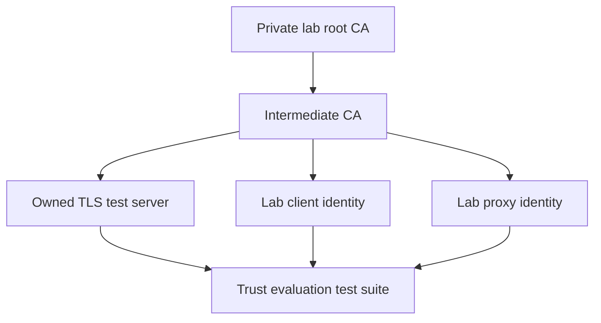

# Phase 2 — TLS and PKI Infrastructure

[Roadmap](README.md) | [Previous](01-network-security.md) | [Next](03-endpoint-security.md)

**Weeks:** 3–4 · **Estimate:** 35–50 hours · **Release:** v0.2.0

**Platforms:** macOS · iOS/iPadOS · tvOS (PKI library and certificate inspector); macOS only (transparent proxy)

**Distribution:** PKI library, inspector and transparent proxy are **Shipped**. The TLS laboratory and any global trust change are **Lab-only**.

**Goal:** Understand trust chains, certificate lifecycle, enterprise trust configuration, proxy behavior and validation failures. Restrict TLS inspection to an isolated laboratory with owned endpoints, test clients and synthetic data.

## 2.1. Certificate management (`WardAxisPKI`)

| ID | Task | Technology |
|---|---|---|
| PKI-001 | PEM and DER parsing | Security.framework |
| PKI-002 | Certificate metadata | Security.framework, Swift Certificates |
| PKI-003 | Fingerprints | CryptoKit SHA-256 |
| PKI-004 | Certificate chain construction | SecTrust |
| PKI-005 | Hostname verification | SecPolicyCreateSSL |
| PKI-006 | Trust evaluation | SecTrustEvaluateWithError |
| PKI-007 | Application-scoped trust anchors | SecTrustSetAnchorCertificates |
| PKI-008 | Keychain identity management | SecItem APIs, shared Keychain access group |
| PKI-009 | Expiration monitoring | Certificate inventory |
| PKI-010 | Trust failure diagnostics | Structured errors |

`WardAxisPKI` builds for macOS, iOS and tvOS; SecTrust, SecItem and CryptoKit are available on all three. Use platform trust evaluation rather than implementing X.509 validation yourself. Keep custom anchors scoped to the laboratory client. Store identities in a Keychain access group that the app and its extensions share; never use files or UserDefaults. Certificate model: subject, issuer, serial, validity, SHA-256 fingerprint, subject alternative names, key algorithm, key usage, trust result and errors.

## 2.2. PKI laboratory (Lab-only)

Use a reproducible Docker Compose environment and established TLS libraries. Keep private keys outside version control. Generate disposable identities; use fixed evaluation dates for deterministic tests where appropriate. Do not modify the primary Mac's global trust configuration or inspect third-party sessions. The shipped app never installs root certificates or changes system trust; lab roots reach test devices only through MDM profiles (Phase 5).

| Fixture | Expected result |
|---|---|
| Valid chain | Trusted |
| Expired certificate | Rejected |
| Future validity date | Rejected |
| Unknown root | Rejected |
| Incorrect hostname | Rejected |
| Missing intermediate | Depends on available chain sources |
| Invalid key usage | Rejected |
| Revoked certificate | Rejected when revocation is established |
| Valid mTLS identity | Authenticated |
| Incorrect mTLS identity | Rejected |

## 2.3. Transparent proxy experiments (macOS)

| ID | Task |
|---|---|
| PKI-011 | NETransparentProxyProvider lifecycle |
| PKI-012 | TCP handling with owned test services |
| PKI-013 | UDP compatibility |
| PKI-014 | Backpressure and bounded buffering |
| PKI-015 | Connection timeouts |
| PKI-016 | Half-close and teardown |
| PKI-017 | Validate loop prevention in the lab |
| PKI-018 | Upstream error propagation |
| PKI-019 | Latency measurement |
| PKI-020 | Failure recovery |

The transparent proxy exists on macOS only. Package it as a system extension; TN3134 permits App Store distribution for this packaging. Separate proxy transport from TLS processing. Forwarding encrypted connections does not provide plaintext visibility; the shipped proxy forwards only and never terminates TLS. Use established TLS implementations for controlled client/server experiments in the lab.

## 2.4. Compatibility research

| Technology | Investigation |
|---|---|
| TLS 1.2 / 1.3 | Handshake and trust behavior |
| HTTP/1.1 | Connection reuse |
| HTTP/2 | Multiplexing |
| HTTP/3 / QUIC | Transport compatibility |
| Certificate pinning | Expected trust rejection; preserve pinning |
| mTLS | Client identity and authentication |
| ALPN | Protocol negotiation |
| SNI / ECH | Hostname visibility limitations |
| OCSP / CRL | Revocation availability and failures |
| System proxy / PAC | Interaction with network extensions |
| VPN | Coexistence and routing behavior |

Record incompatibilities and document explicit exclusions. Never weaken trust controls to make an incompatible client work.

## 2.5. UI

Certificate inspector on macOS, iOS and tvOS: certificate inventory; expiration notifications; root/intermediate/leaf chain visualization; trust diagnostics for hostname, chain and validity. Show evidence and the trust evaluation context, including evaluation date and policy. On tvOS, show a read-only summary with focus-based navigation.

## Acceptance criteria

- [ ] Inspector validates chains and explains failures on all three platforms.
- [ ] Each fixture has an automated test.
- [ ] Valid mTLS succeeds; invalid identities and certificates are rejected.
- [ ] Proxy experiments demonstrate correct connection lifecycle on macOS.
- [ ] Compatibility report covers VPN, pinned TLS and QUIC behavior.
- [ ] No trust configuration changes required on the primary development Mac.
- [ ] The shipped build contains no custom root anchors; app-scoped test anchors exist only in debug builds.

**Deliverables:** Multiplatform PKI library, reproducible TLS laboratory, certificate inspector, compatibility report, v0.2.0 TestFlight release.

**Skills:** PKI, X.509, TLS, proxy architecture, mTLS, Keychain trust management.

## References

- [Apple Security](https://developer.apple.com/documentation/security)
- [SecTrust](https://developer.apple.com/documentation/security/sectrust)
- [NETransparentProxyProvider](https://developer.apple.com/documentation/networkextension/netransparentproxyprovider)
- [TN3134](https://developer.apple.com/documentation/technotes/tn3134-network-extension-provider-deployment)
- [Swift Certificates](https://github.com/apple/swift-certificates)
- [SwiftNIO SSL](https://github.com/apple/swift-nio-ssl)
