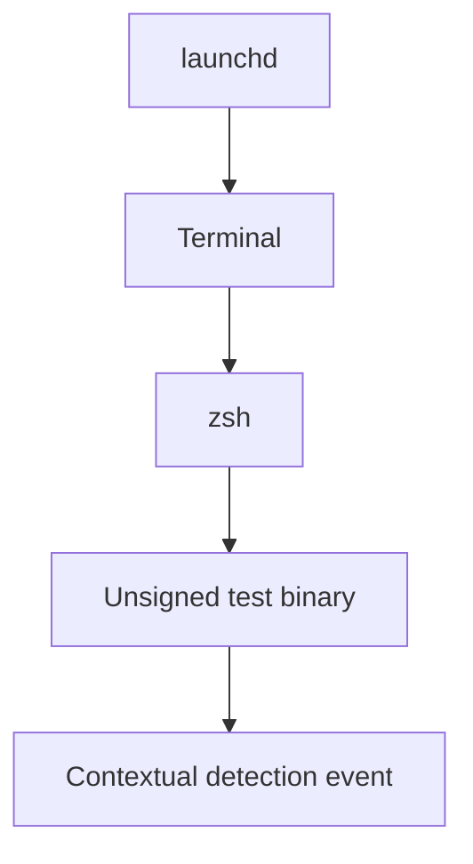
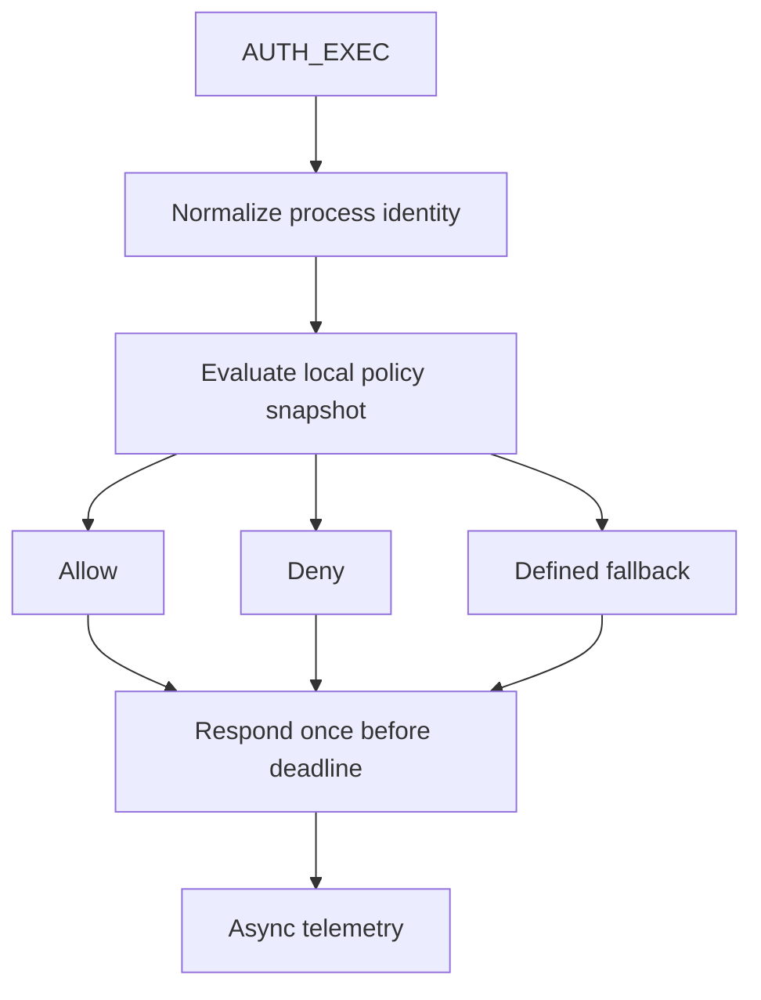

# Phase 3 — Secure IPC and EDR Lab Track

[Roadmap](README.md) | [Previous](02-tls-pki.md) | [Next](04-ai-dlp.md)

**Weeks:** 5–6 · **Estimate:** 40–55 hours · **Release:** v0.3.0

**Platforms:** macOS (agent, lab EDR) · iOS/iPadOS and tvOS (shared IPC contracts and App Group storage)

**Distribution:** §3.1 is **Shipped**. §3.2–3.6 are **Lab-only**: they compile only under `WARDAXIS_LAB`, use a separate Developer ID scheme and never appear in an App Store archive.

**Goal:** Ship a sandboxed agent and authenticated IPC that connect the app, its extensions and the management agent. In the lab, build an event-driven macOS runtime security engine with process monitoring, behavioral detection and controlled authorization.

> App Store apps must be sandboxed and cannot request root (guideline 2.4.5(i), (v)). EndpointSecurity needs root, Full Disk Access and a restricted entitlement, so the EDR engine is a research track. Confirm the App Store position with Apple DTS and record it in ADR-005.

## 3.1. Sandboxed agent and IPC (Shipped)

| ID | Task | Platform |
|---|---|---|
| IPC-001 | `SMAppService.loginItem` sandboxed agent; registration only after user consent; health and status | macOS |
| IPC-002 | Versioned XPC protocol | macOS |
| IPC-003 | Peer code-signing validation | macOS |
| IPC-004 | Per-operation authorization | All |
| IPC-005 | Input size and schema validation | All |
| IPC-006 | Reconnection and agent restart | macOS |
| IPC-007 | Policy snapshot distribution to providers through NE provider configuration and messaging | All |
| IPC-008 | Administrative action audit log | All |
| IPC-009 | App Group container storage shared by app, agent and app extensions | All |
| IPC-010 | Channel between app and system extensions (NE Mach service or provider messaging); verify under the sandbox | macOS |

Keep agent responsibilities limited. Authenticate callers with supported peer-identity APIs, validate payloads, and separate read-only telemetry from administrative commands. Reject unknown versions and unauthorized requests. The agent runs only with consent and stops when the user turns protection off (guideline 2.4.5(iii)). On iOS and tvOS there is no agent: the app and its extensions share the App Group and the same IPC schemas.

## 3.2. EndpointSecurity integration (Lab-only)

| ID | Task |
|---|---|
| EDR-001 | ES client initialization |
| EDR-002 | Entitlement and Full Disk Access diagnostics |
| EDR-003 | Event subscription management |
| EDR-004 | C-to-Swift event normalization |
| EDR-005 | Message lifetime management |
| EDR-006 | Bounded event queue |
| EDR-007 | Sequence and loss tracking |
| EDR-008 | Authorization deadline handling |
| EDR-009 | Local policy snapshots |
| EDR-010 | Subscription health monitoring |

Authorization events have deadlines. Keep responses independent of remote APIs, database writes, UI interaction, and ML inference. Handle borrowed C message lifetimes explicitly; retain/release where required and normalize before crossing concurrency domains. Maintain Swift 6 Sendable boundaries and measure queue pressure. Track seq_num/global_seq_num where supported by the message version. The ES client sends normalized events to the agent through the IPC contracts from §3.1.

## 3.3. Events (Lab-only)

| Event | Purpose | Priority |
|---|---|---|
| NOTIFY_EXEC | Execution | P0 |
| NOTIFY_FORK | Relationships | P0 |
| NOTIFY_EXIT | Lifecycle | P0 |
| AUTH_EXEC | Execution authorization | P0 |
| NOTIFY_CREATE | Creation | P1 |
| NOTIFY_RENAME | Movement | P1 |
| NOTIFY_UNLINK | Deletion | P1 |
| NOTIFY_WRITE | Modification | P1 |
| NOTIFY_MOUNT | Volume monitoring | P2 |
| AUTH_OPEN | Protected test-file authorization | P2 |

Begin with notifications; add authorization only after event parsing and deadline monitoring work. File notifications do not guarantee full coverage of filesystem operations.

## 3.4. Process graph (`WardAxisProcess`, Lab-only)

Track audit-token-derived identity, process start information, parent identity, signing identifier, Team ID, executable path and code-signing status. Handle PID reuse, orphaned processes, missing parent events, executable replacement, and agent startup after processes are running. Use bounded graph retention and deterministic replay.

## 3.5. Behavioral detection (Lab-only)

| ID | Detection | MITRE ATT&CK |
|---|---|---|
| DET-001 | Launch Agent creation | T1543.001 |
| DET-002 | Launch Daemon creation | T1543.004 |
| DET-003 | Login Item registration | T1547.015 |
| DET-004 | Shell execution | T1059.004 |
| DET-005 | Unexpected signing identity | Project-specific |
| DET-006 | Execution from monitored test temporary directory | Project-specific |
| DET-007 | Unexpected modification of protected test file | Project-specific |
| DET-008 | Multiple correlated risk indicators | Behavioral correlation |

Use harmless fixtures and replay. An unsigned executable or shell event alone is contextual telemetry, not proof of maliciousness. Record the rule version, evidence and confidence. Keep rules distinct from enforcement policies. A detection moves to the shipped build only if it works without ES and inside the sandbox (for example, DET-001 through a file-presence check on user-accessible paths); mark each such candidate "verify sandbox access" and record the result.

## 3.6. Authorization engine (Lab-only)

- Default to audit mode on new deployments.
- Keep a last-known-good policy and define fallback per event type.
- Respond exactly once; track remaining deadline and response errors.
- Invalidate relevant authorization caches when policy changes.
- Keep storage and remote calls out of the critical path.
- Use test-only executable and file rules before broader enforcement.

## Acceptance criteria

Shipped:

- [ ] The agent registers only after consent and stops when protection is turned off.
- [ ] Unauthorized XPC clients rejected.
- [ ] Policy snapshots reach every provider on all three platforms through supported channels.
- [ ] App Store archives contain no ES symbols, ES entitlement or `WARDAXIS_LAB` code (enforced in CI).

Lab-only (results labeled "lab build"):

- [ ] Process events appear in live graph; replay reproduces decisions.
- [ ] Synthetic test executable denied by explicit test policy.
- [ ] No deadline misses in defined stress test; publish latency and loss metrics.
- [ ] Offline management connectivity does not affect local decisions.
- [ ] If the restricted entitlement is pending, synthetic adapter and tests complete, and actual integration remains marked blocked.

**Deliverables:** Sandboxed agent, secure IPC and App Group storage (shipped); ES client, process graph, detection engine and fixtures (lab); v0.3.0 TestFlight release.

**Skills:** Sandboxed IPC, XPC, App Groups, EndpointSecurity (lab), audit tokens, runtime security, authorization deadlines, process attribution.

## References

- [App Sandbox](https://developer.apple.com/documentation/security/app-sandbox)
- [SMAppService](https://developer.apple.com/documentation/servicemanagement/smappservice)
- [XPC](https://developer.apple.com/documentation/xpc)
- [EndpointSecurity](https://developer.apple.com/documentation/endpointsecurity) (lab track)
- [System Extensions](https://developer.apple.com/system-extensions/)
- [MITRE ATT&CK macOS](https://attack.mitre.org/matrices/enterprise/macos/)
- [Santa](https://github.com/northpolesec/santa)
