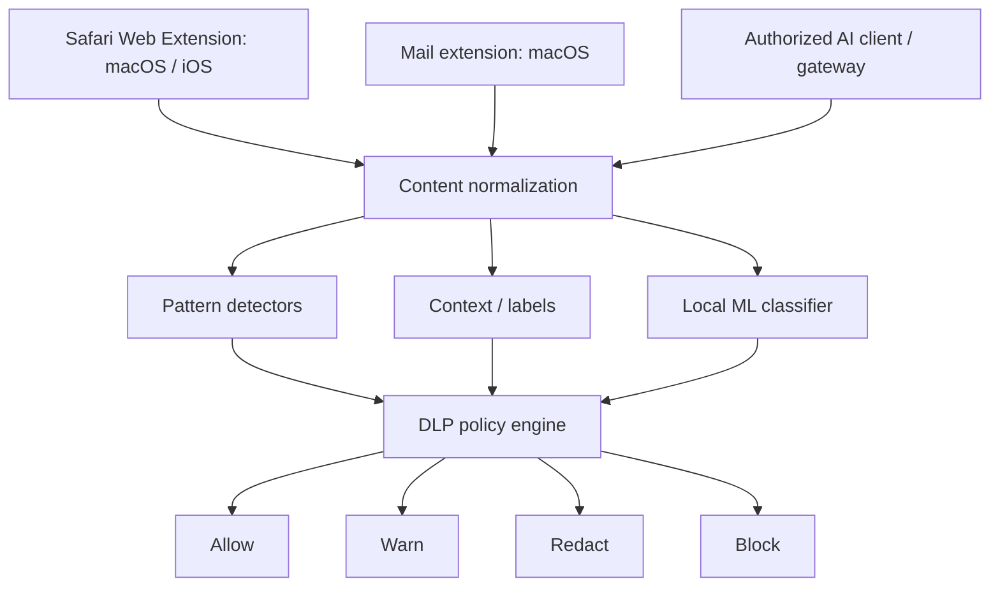

# Phase 4 — AI Data Loss Prevention, Safari and Mail Extensions

[Roadmap](README.md) | [Previous](03-endpoint-security.md) | [Next](05-enterprise-management.md)

**Weeks:** 7–8 · **Estimate:** 50–70 hours · **Release:** v0.4.0

**Platforms:** macOS (DLP engine, Safari, Mail) · iOS/iPadOS (DLP engine, Safari) · tvOS (DLP status only)

**Distribution:** DLP engine, Safari Web Extension and Mail extension are **Shipped**. The AI gateway is a separate server or developer component; it is not part of the App Store app.

**Goal:** Policy-driven protection of sensitive information sent to AI services and by email, through explicitly supported integrations. All classification runs on-device.

## 4.1. AI service registry

| Service | Class |
|---|---|
| OpenAI / ChatGPT | External AI |
| Anthropic / Claude | External AI |
| Google Gemini | External AI |
| GitHub Copilot | Development assistant |
| Cursor | Development assistant |
| Ollama | Local / self-hosted AI |
| LM Studio | Local / self-hosted AI |
| Custom endpoint | Organization-managed AI |

| ID | Task |
|---|---|
| DLP-001 | Configurable service registry |
| DLP-002 | Endpoint classification |
| DLP-003 | Application identity correlation |
| DLP-004 | Organization-managed policies |
| DLP-005 | Registry updates and versioning |

Service identification is imperfect: shared infrastructure, encrypted DNS, changing hostnames and custom gateways limit certainty. Distinguish unknown from classified traffic. The registry also defines the Safari extension's host permissions; registry updates are data and never add code (guideline 2.4.5(iv)).

## 4.2. Sensitive data classification (`WardAxisDLP`)

| Detector | Method | Priority |
|---|---|---|
| API keys | Provider-specific patterns | P0 |
| Private keys | Structured format detection | P0 |
| Access tokens | Pattern and context | P0 |
| Connection strings | URL / credential structure | P0 |
| Credit card numbers | Pattern and Luhn validation | P1 |
| Email addresses | Pattern recognition | P1 |
| Personal information | Contextual classification | P1 |
| Source code | Language classification | P1 |
| Internal documents | Configurable labels and fingerprints | P2 |
| Confidential text | Local CoreML model | P2 |

`WardAxisDLP` builds for macOS, iOS and tvOS. Detector output: classification, confidence, range, severity and detector version. Matched values remain out of ordinary event logs. Bound input size and detector runtime; resolve overlapping ranges before redaction. Extensions have tight memory limits; measure detector memory inside each extension.

## 4.3. Processing pipeline



| Mode | Platform | Visibility | Capability |
|---|---|---|---|
| Network enforcement | All | Destination and flow metadata | Service allow/block |
| Safari Web Extension | macOS, iOS | Prompt text on registered AI web apps, before submit | Classification, warnings, redaction, blocking |
| Mail extension (MailKit) | macOS | Recipients and body of a message being composed | Annotation, warnings, send blocking |
| Integrated content enforcement | Any client | Content provided by an authorized client or gateway | Classification, warnings, redaction, blocking |

Network filtering cannot generally read encrypted HTTPS request bodies. The Safari and Mail extensions see content only inside their supported scopes. The gateway is opt-in and handles only requests from integrated clients. Keep credential detection deterministic; ML never overrides high-confidence credential findings.

## 4.4. Safari Web Extension (macOS, iOS)

| ID | Task |
|---|---|
| DLP-016 | Content scripts for registered AI web apps; extract prompt text at submit |
| DLP-017 | Native messaging to the containing app; call `WardAxisDLP` on-device |
| DLP-018 | Warn, redact or block in the page; acknowledgement flow for warnings |
| DLP-019 | Host permissions generated from the service registry; no `<all_urls>` |
| DLP-020 | Tests: JS/TS unit tests, fixture pages, permission-revoked and disabled-extension states |

Request site access only for registered AI domains (guideline 4.4.2). Never modify Safari or system UI. Treat page content as untrusted input. The extension must work with a bounded time budget and fail to a documented state (warn or allow) when the native host is unavailable.

## 4.5. Mail extension (macOS, MailKit)

| ID | Task |
|---|---|
| DLP-021 | `MEComposeSessionHandler`: scan recipients and body during composition |
| DLP-022 | Recipient annotations for external or unapproved domains |
| DLP-023 | Block send through `allowMessageSendForSession` when policy denies, with a clear reason |
| DLP-024 | Tests: fixture messages, attachments metadata, large bodies, disabled-extension state |

`MEMessageSecurityHandler` (signing and encryption) is optional and out of MVP scope. The Mail extension never uploads message content; it records only classification, decision and detector version.

## 4.6. AI gateway (server component)

OpenAI-compatible requests first, Anthropic integration second. Use a mock upstream for integration tests; real provider integration is optional. The gateway runs on the lab server or a developer machine; the App Store app does not embed it.

| ID | Task |
|---|---|
| DLP-006 | Request schema validation |
| DLP-007 | Provider abstraction |
| DLP-008 | Input size limits |
| DLP-009 | Text and message extraction |
| DLP-010 | Sensitive data classification |
| DLP-011 | Policy evaluation |
| DLP-012 | Context-aware redaction |
| DLP-013 | Streaming response forwarding |
| DLP-014 | Provider error handling |
| DLP-015 | Redacted audit events |

```json
{
  "service": "external-ai",
  "rules": [
    {"classification": "private-key", "action": "block"},
    {"classification": "api-key", "action": "block"},
    {"classification": "personal-information", "action": "redact"},
    {"classification": "source-code", "action": "warn"}
  ]
}
```

Define how warnings are acknowledged before sending. Validate redaction at parsed field boundaries. Test streaming cancellation, timeouts, provider errors and malformed inputs; do not log request bodies or authorization headers.

## 4.7. Local ML and evaluation

Classes: public, internal, confidential, restricted and source code. Use NaturalLanguage or CoreML, synthetic data, and local processing. Ship the model inside the app bundle; do not download models at runtime. Create at least 1,000 labeled samples covering sensitive/non-sensitive text, fake credentials in code, multilingual content, Unicode, formatting variations, long inputs, false positives and mixed classifications. Split by template/family to limit dataset leakage between train/validation/test.

| Metric | Initial target |
|---|---:|
| Structured credential precision | ≥98% |
| Structured credential recall | ≥95% |
| Local classification p95 (10 KB) | ≤100 ms |
| Deterministic detection p95 (10 KB) | ≤10 ms |
| Safari submit-to-decision p95 | ≤150 ms |
| Sensitive values in telemetry | 0 |
| Correct fixture policy decisions | 100% |

Publish per-detector metrics, dataset composition, false-positive and false-negative examples, latency method, and actual results per platform. Synthetic performance does not establish real-world detection quality.

## 4.8. Privacy

All classification stays on-device; prompt and message content is never uploaded (guidelines 5.1.1, 5.1.2(i)). Show what the extensions inspect in the consent screen and in the App Store description (guideline 4.4). Telemetry contains classifications, decisions and versions only. The tvOS app shows DLP policy and status but inspects no content.

## Acceptance criteria

- [ ] Integrated test client sends through the gateway.
- [ ] The Safari extension blocks a fake private key on the test AI page on macOS and iOS.
- [ ] The Mail extension blocks sending a message that contains a fake private key.
- [ ] Fake private keys and API tokens blocked in every mode.
- [ ] Redaction preserves valid JSON.
- [ ] Telemetry contains classifications rather than matched sensitive values.
- [ ] Unknown services receive defined policy.
- [ ] Streaming and cancellation work.
- [ ] Safari host permissions are limited to registered AI domains.
- [ ] Dataset, precision/recall and limitations documented.

**Deliverables:** DLP engine, Safari Web Extension, Mail extension, gateway, local classifier, synthetic dataset, benchmark report, v0.4.0 TestFlight release.

**Skills:** DLP, AI security, Safari Web Extensions, MailKit, policy-driven content protection, local ML, secure gateway architecture.

## References

- [Safari web extensions](https://developer.apple.com/documentation/safariservices/safari-web-extensions)
- [MailKit](https://developer.apple.com/documentation/mailkit)
- [CoreML](https://developer.apple.com/documentation/coreml)
- [NaturalLanguage](https://developer.apple.com/documentation/naturallanguage)
- [App Review Guidelines 4.4 and 5.1](https://developer.apple.com/app-store/review/guidelines/)
