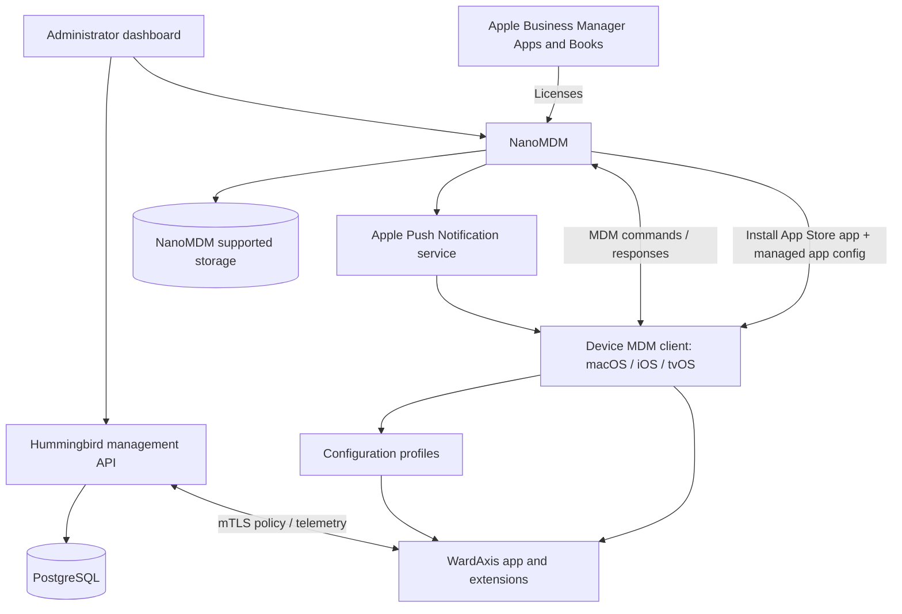

# Phase 5 — Enterprise Management and MDM

[Roadmap](README.md) | [Previous](04-ai-dlp.md) | [Next](06-production-engineering.md)

**Weeks:** 9–10 · **Estimate:** 45–60 hours · **Release:** v0.5.0

**Platforms:** macOS · iOS/iPadOS · tvOS

**Distribution:** The management agent in the app is **Shipped**. NanoMDM, the Hummingbird backend and the dashboard are separate server components. The App Store app does not offer MDM features and does not install configuration profiles (guideline 5.5).

**Goal:** Centrally managed enterprise security agent on all three platforms. Use NanoMDM for operating-system management, Apple Business Manager for managed App Store distribution, and a separate Hummingbird backend for WardAxis policy and telemetry. Do not implement a custom MDM protocol server for the MVP.

## 5.0. Prerequisite: organization enrollment

ORG-001 is the first Phase 5 task. Development in Phases 0–4 runs on a paid individual Apple Developer account. That account signs every NetworkExtension capability for development and internal TestFlight.

| Item | Detail |
|---|---|
| Task | Enroll Agnidia as an **organization** and move `DEVELOPMENT_TEAM` to the organization team |
| Why now | MDM-004 needs an MDM push certificate. Apple grants the certificate-signing capability only to organization accounts. App Review of the packet tunnel build also needs one (guideline 5.4) |
| Lead time | D-U-N-S verification can take weeks. Start the enrollment before Phase 5 so it does not block MDM-004 |
| Migration | The team ID changes. Register the bundle IDs, App Groups and Keychain access groups under the new team. Development Keychain items stored under the old team prefix are not migrated |
| Blocks | MDM-004, external TestFlight and App Store submission (Phase 6) |

## 5.1. Architecture

Use the Raspberry Pi 5 or another separate test server for infrastructure. Test enrollment on a dedicated Mac or a VM that supports the required enrollment and extension behavior, a supervised iPhone or iPad, and an Apple TV. Keep MDM and WardAxis authentication boundaries separate.

## 5.2. Infrastructure

| ID | Task |
|---|---|
| MDM-001 | Deploy NanoMDM |
| MDM-002 | Configure supported persistent storage |
| MDM-003 | Configure HTTPS endpoint |
| MDM-004 | Obtain valid MDM APNs credentials |
| MDM-005 | Configure enrollment and device identity |
| MDM-006 | Enroll dedicated test Mac |
| MDM-007 | Monitor enrollment status |
| MDM-008 | Validate command delivery |
| MDM-009 | Device removal and unenrollment |
| MDM-010 | Infrastructure backup and restore |
| MDM-011 | Enroll and supervise a test iPhone or iPad |
| MDM-012 | Enroll a test Apple TV |
| MDM-013 | Apple Business Manager Apps and Books: assign licenses and install the App Store app through MDM |
| MDM-014 | Managed app configuration: management server URL, enrollment token, policy channel |
| MDM-015 | Declarative device management status reports for posture |

Real enrollment requires valid MDM APNs credentials, HTTPS, an enrollment configuration, supported enrollment and appropriate administrative approval. NanoMDM is a protocol implementation rather than a complete out-of-the-box fleet management product. If credentials or enrollment are blocked, use a simulator for server integration tests and label all simulated results. The App Store app is the only agent install path; there is no PKG.

## 5.3. Configuration profiles

Version-control lab `.mobileconfig` templates and validate against Apple's schema. Keep credentials and device-specific values outside source control. NanoMDM delivers all profiles; the app never ships or installs them.

| Profile | Payload type | Platform |
|---|---|---|
| System Extension approval | com.apple.system-extension-policy | macOS |
| Content filter configuration | com.apple.webcontent-filter | macOS; iOS supervised or per-app managed |
| DNS proxy configuration | com.apple.dnsProxy.managed | iOS supervised or per-app managed |
| VPN / packet tunnel | com.apple.vpn.managed | iOS, tvOS |
| Privacy preferences (PPPC) | com.apple.TCC.configuration-profile-policy | macOS |
| Certificate deployment | com.apple.security.root | All (test devices only) |
| Managed background services | com.apple.servicemanagement | macOS |
| Managed application preferences | com.apple.ManagedClient.preferences | macOS |

Validate enrollment requirements, payload compatibility, supported approval behavior and removal on macOS 26, iOS 26 and tvOS 26. Use lab certificate trust only on dedicated managed test devices. Verify installation, profile replacement, removal, and restoration of intended configuration. Document which approvals still require user action.

## 5.4. Device posture assessment

| Check | macOS | iOS | tvOS | Reported state |
|---|:---:|:---:|:---:|---|
| FileVault | MDM | — | — | Enabled / disabled / unknown |
| System Integrity Protection | MDM | — | — | Enabled / disabled / unknown |
| Gatekeeper | MDM | — | — | Enabled / disabled / unknown |
| Application firewall | MDM | — | — | Enabled / disabled / unknown |
| Passcode set | — | App | — | Set / not set / unknown |
| OS version | App, MDM | App, MDM | App, MDM | Version / compliance |
| System Extension | App | — | — | Activation state |
| URL filter / content filter / tunnel | App | App | App | Configuration state |
| Safari / Mail extension | App (enabled state where available) | App | — | Enabled / disabled / unknown |
| Background agent | App | — | — | Running / unavailable |
| Certificate expiration | App | App | App | Time remaining |
| Security policy | App | App | App | Applied revision / validity |
| EndpointSecurity client health | Lab-only | — | — | Healthy / unavailable |

"App" means the sandboxed app reports it; "MDM" means NanoMDM or declarative status reports supply it. The sandbox blocks many system checks, so the app reports them as unknown and the dashboard merges MDM evidence. Include collection timestamp, evidence source and errors. Read-only posture collection must never silently change security settings.

## 5.5. Management API

| Method | Endpoint | Purpose |
|---|---|---|
| POST | /v1/devices/enroll | Register authorized agent |
| GET | /v1/devices | List endpoints |
| GET | /v1/devices/:id | Endpoint details |
| POST | /v1/devices/:id/heartbeat | Health and status |
| POST | /v1/devices/:id/events | Telemetry batch |
| GET | /v1/devices/:id/policy | Retrieve policy |
| POST | /v1/devices/:id/policy-status | Acknowledge applied revision |
| POST | /v1/policies | Create policy version |
| GET | /v1/policies/:id | Retrieve policy |
| POST | /v1/policies/:id/assign | Assign policy |

Agents run on macOS, iOS and tvOS. Use authenticated enrollment (token from managed app configuration), mTLS for enrolled agents, separate administrator authentication, per-device resource authorization, size limits, idempotency and bounded event batches. Store the mTLS identity in the Keychain access group that the app and its extensions share. Verify transport peer identity at the correct trust boundary; never trust a user-supplied identity header.

## 5.6. Signed policies

| Field | Purpose |
|---|---|
| schemaVersion | Format compatibility |
| policyID | Policy identity |
| revision | Monotonic revision |
| issuedAt | Issuance time |
| expiresAt | Expiration |
| deviceScope | Authorized recipients |
| keyID | Trusted signing key |
| payload | Serialized policy bytes |
| signature | Cryptographic signature |

Use CryptoKit Ed25519 (`Curve25519.Signing`). Sign a defined byte representation covering the payload and all security-relevant envelope metadata; avoid depending on incidental JSON serialization order. Keep signing keys separate from TLS identities. Persist accepted revision state, validate scope and expiration, and define key rotation, offline behavior and rollback via a new signed revision. Policies are data; they never deliver executable code (guideline 2.4.5(iv)).

Deployment sequence:

1. Administrator creates policy revision.
2. Server validates and signs canonical envelope.
3. Endpoint retrieves using authenticated transport.
4. Endpoint verifies signature, scope, revision, expiration and schema.
5. Endpoint compiles validated policy into immutable local snapshot.
6. Providers and extensions adopt the new snapshot through supported mechanisms.
7. Endpoint acknowledges applied revision and deployment result.

Test invalid signatures, replayed revisions, wrong device scope, expired policies, clock changes, key rotation, malformed payloads, interrupted updates and offline behavior.

## 5.7. Fleet dashboard

Implement endpoint list with platform, compliant / attention / offline counts, last heartbeat, OS version, posture evidence with its source, policy assignment and applied revision, provider and extension health, event summaries, enrollment status and App Store app version. Clearly distinguish offline devices and unknown status from verified noncompliance.

## Acceptance criteria

- [ ] One Mac, one supervised iPhone or iPad and one Apple TV enrolled, subject to credentials and platform support.
- [ ] The App Store app installs on each device through Apple Business Manager managed distribution.
- [ ] Managed app configuration enrolls the agent without manual entry.
- [ ] System Extension and content filter profiles validated on macOS; content filter and DNS proxy profiles validated on the supervised iOS device.
- [ ] Remote policy updates arrive and are acknowledged on all three platforms.
- [ ] Invalid, expired, wrong-scope and replayed policies rejected.
- [ ] Offline endpoints continue applying the last-known-good policy according to documented expiry semantics.
- [ ] Certificate and signing-key rotation tested.
- [ ] Posture and health visible centrally, with evidence source per check.
- [ ] Unenrollment and removal tested.
- [ ] Load test covers 100 simulated endpoints, with simulated status explicit.

**Deliverables:** Hummingbird backend, Docker infrastructure, NanoMDM integration, managed App Store distribution, configuration profiles, signed policy protocol, dashboard, v0.5.0 TestFlight release.

**Skills:** Apple enterprise deployment, MDM, declarative device management, managed app distribution, APNs, mTLS, posture, fleet management, signed policy distribution.

## References

- [NanoMDM](https://github.com/micromdm/nanomdm)
- [NanoMDM quickstart](https://github.com/micromdm/nanomdm/blob/main/docs/quickstart.md)
- [Apple Device Management](https://developer.apple.com/documentation/devicemanagement)
- [Apple configuration profile schemas](https://github.com/apple/device-management)
- [Apple Business Manager](https://support.apple.com/guide/apple-business-manager/welcome/web)
- [App Review Guideline 5.5](https://developer.apple.com/app-store/review/guidelines/)
- [CryptoKit](https://developer.apple.com/documentation/cryptokit)
