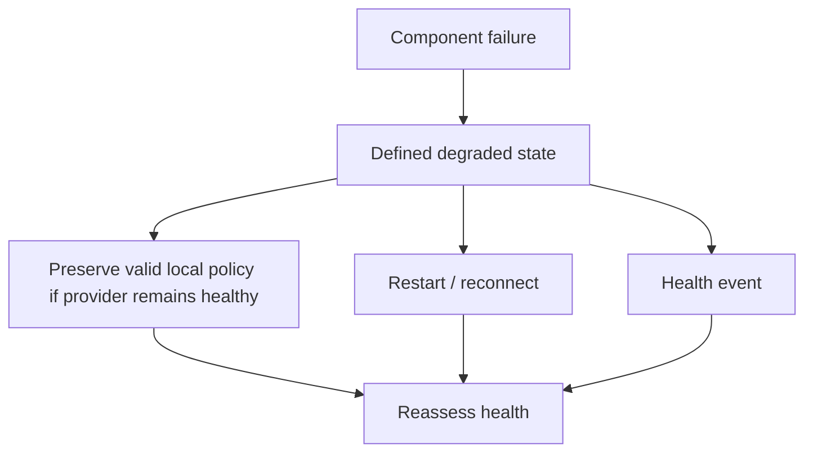

# Phase 6 — Production Engineering

[Roadmap](README.md) | [Previous](05-enterprise-management.md)

**Weeks:** 11–12 · **Estimate:** 35–50 hours · **Release:** v1.0.0 (App Store)

**Platforms:** macOS · iOS/iPadOS · tvOS

**Distribution:** All tasks are **Shipped** unless marked **Lab-only**.

**Goal:** Demonstrate reliability, security testing, resource efficiency, App Store distribution and operational competencies expected of senior/staff Apple-platform security engineers.

## 6.1. BenchmarkRunner

| ID | Task | Measurement | Platform |
|---|---|---|---|
| PERF-001 | Idle consumption per process (app, agent, each extension) | CPU, RAM | All |
| PERF-002 | Network filtering overhead | Added latency, throughput | All |
| PERF-003 | Policy lookup | p50, p95, p99 | All |
| PERF-004 | EndpointSecurity throughput (**Lab-only**) | Events/sec, dropped events | macOS |
| PERF-005 | Authorization processing (**Lab-only**) | Latency, deadline misses | macOS |
| PERF-006 | Memory pressure, including extension memory limits | Allocations, growth | All |
| PERF-007 | Database | Inserts/sec, query latency | All |
| PERF-008 | DLP classification (engine, Safari, Mail) | Latency, precision, recall | macOS, iOS |
| PERF-009 | Management API | Requests/sec | Server |
| PERF-010 | Energy | CPU wakeups, power impact | All |

### Targets (unmeasured)

| Metric | Initial target |
|---|---:|
| Idle CPU | <1% |
| Core agent memory (excluding UI / ML runtime) | <50 MB |
| Policy evaluation p99 | <1 ms |
| Flow decision overhead p99 | <5 ms |
| Safari submit-to-decision p95 | ≤150 ms |
| Synthetic event throughput (lab) | 10,000/sec |
| Authorization deadline misses (lab) | 0 |
| Agent and provider recovery | <3 sec |
| Nominal-load event loss | 0 |
| Continuous workload test | 24 hours |

Use Mac mini M4, a current iPhone and Apple TV 4K as reference hardware. Specify OS version, memory, build settings, workload, warm-up, repetitions, sample counts, measurement tools and percentiles. Compare against baseline without the app. Report separate process footprints, synthetic versus real event rates, peak and steady-state load. Label lab-build results separately. Do not claim targets as actual results.

### Tools

Instruments Time Profiler, Allocations, Leaks, System Trace; OSSignposter; vmmap; powermetrics; Address Sanitizer; Thread Sanitizer; Swift strict concurrency; Safari Web Inspector for the extension. Run sanitizers and performance benchmarks separately.

## 6.2. Reliability and fault injection

| Scenario | Expected behavior |
|---|---|
| Agent / login item termination | Restart and reconnect |
| Network extension termination | Recovery measured and documented |
| URL filter or packet tunnel termination | Recovery measured and documented |
| Safari extension disabled by the user | Health event; posture reports disabled |
| Mail extension disabled by the user | Health event; posture reports disabled |
| EndpointSecurity client termination (**Lab-only**) | Health reporting and recovery |
| Management server unavailable | Local policy continues where provider is healthy |
| Invalid policy | Previous valid policy retained |
| SQLite unavailable | Enforcement independent of DB |
| Disk full | Bounded loss, health warning |
| Queue overflow | Loss measured, memory bounded |
| Certificate expired | Authentication failure reported |
| Clock changes | Defined policy and certificate behavior |
| Sleep/wake | Providers recover |
| Network changes | No persistent connectivity disruption |
| App Store update while extensions are active | Extensions replaced; last-known-good policy restored |
| App deleted | System extensions deactivate; App Group data removed |

Distinguish loss of remote connectivity from loss of enforcement. Provider failure semantics depend on the OS and configuration; measure actual behavior per platform and document gaps. Test every failure in owned lab systems.

## 6.3. Threat model

Complete [docs/THREAT-MODEL.md](../docs/THREAT-MODEL.md) (started in PRE-008): assets, assumptions, trust boundaries, abuse cases, mitigations, verification and residual risks. Replace every `TBD` cell of its threat register.

| Threat | Mitigation |
|---|---|
| Spoofing | mTLS device identity, XPC peer authentication |
| Tampering | Signed policies, code signing, App Sandbox, protected storage |
| Repudiation | Structured event identity and audit records |
| Information disclosure | Data minimization, on-device classification, redacted telemetry |
| Denial of service | Bounded queues, deadlines, limits |
| Elevation of privilege | Sandboxed components, no root, authenticated administrative operations |

Include boundaries between the sandboxed app, login item agent, system and app extensions, Safari Web Extension (web page content is untrusted), Mail extension (message content is untrusted), local database, AI gateway, MDM server and management API. Model the lab ES client as a separate, unshipped boundary. Document limits against attackers with administrative or kernel privileges, and against users who disable extensions. Do not imply tamper-proof audit or comprehensive protection.

## 6.4. Security tests

| ID | Task |
|---|---|
| SEC-001 | Malformed policy input |
| SEC-002 | Invalid signatures |
| SEC-003 | Policy replay and revisions |
| SEC-004 | Unauthorized XPC clients |
| SEC-005 | Oversized IPC messages |
| SEC-006 | Database corruption recovery |
| SEC-007 | Certificate validation |
| SEC-008 | Unauthorized device API access |
| SEC-009 | Cross-device authorization |
| SEC-010 | Sensitive data leakage tests |
| SEC-011 | Dependency vulnerability scanning |
| SEC-012 | DNS and JSON parser fuzz testing |
| SEC-013 | Hostile web page against the Safari extension (message spoofing, DOM injection) |
| SEC-014 | Malformed and oversized messages against the Mail extension |
| SEC-015 | App Store archive audit: sandbox on, no lab symbols or entitlements, privacy manifest present |

Use controlled test systems and synthetic inputs. Record expected versus actual outcomes and regression tests for each defect.

## 6.5. Event storage and retention

| Requirement | Implementation |
|---|---|
| Database | SQLite WAL in the App Group container |
| Ingestion | Batched writes |
| Queue | Configurable bounded queue |
| Retention | 7 days by default |
| DB size | Configurable limit, including WAL handling |
| Search | Indexed time, process identity, category |
| Sync | Batched telemetry uploads, opt-in |
| Duplicates | Idempotent event IDs |
| Offline | Bounded persistent outbox |
| Minimization | Metadata instead of raw request content |

Measure realistic event distributions. Avoid a transaction per event. Define queue overflow, retry/backoff, retention deletion, corruption and disk-pressure behavior; never block enforcement on persistence. Data protection classes apply on iOS and tvOS.

## 6.6. CI/CD and distribution

| Workflow | Responsibility |
|---|---|
| PullRequest.yml | Build for macOS, iOS and tvOS; unit tests; formatting |
| IntegrationTests.yml | Platform integration on dedicated devices |
| SecurityScan.yml | Dependency and secret scanning; archive audit (SEC-015) |
| Performance.yml | Reproducible benchmarks |
| AppStore.yml | Archive, export and upload to App Store Connect / TestFlight |
| LabBuild.yml | **Lab-only.** Developer ID lab build; internal artifact, never published |

Use a dedicated trusted macOS runner and test devices for tests involving installed extensions, approvals and entitlements. Hosted CI can compile and run simulator and platform-independent tests. Restrict App Store Connect API keys and signing credentials to the release workflow, separate untrusted pull-request jobs, and verify archives before upload.

Release sequence:

1. Run package, Xcode and extension tests on all platforms.
2. Archive the macOS, iOS and tvOS apps with their embedded extensions.
3. Validate the sandbox, entitlements and provisioning; confirm no lab symbols or entitlements.
4. Validate privacy manifests and App Privacy labels against actual data use.
5. Upload through the App Store Connect API.
6. Distribute to TestFlight testers; run the install, update and removal checks below.
7. Submit for App Review with notes: entitlement rationale, demo video, test account, managed-device setup.
8. Release with phased release enabled.
9. Publish release notes, limitations and benchmark results.

Test fresh installation, App Store update from the previous version, extension re-enablement after update, removal through app deletion, system extension deactivation, and reinstallation. Document how users and administrators disable each extension and remove the app.

## Acceptance criteria

- [ ] Reproducible benchmark report published with actual measurements per platform.
- [ ] Continuous 24-hour workload passes defined limits.
- [ ] Critical policy, signature, IPC and extension security tests pass.
- [ ] Memory growth and loss are measured and within documented bounds.
- [ ] Threat model and residual limitations published.
- [ ] App approved on the App Store for macOS, iOS and tvOS; until approval, distribution is TestFlight only.
- [ ] The lab build is not published; lab results are labeled.
- [ ] Installation, update, recovery and removal tested and documented.

**Deliverables:** Benchmark suite, raw measurement data, threat model, security tests, App Store release pipeline, App Store listing for three platforms, v1.0.0 App Store release.

**Skills:** Security product reliability, performance optimization, App Store distribution and review, threat modeling, incident and failure recovery.

## References

- [Apple Platform Security](https://support.apple.com/guide/security/welcome/web)
- [App Review Guidelines](https://developer.apple.com/app-store/review/guidelines/)
- [App Store Connect API](https://developer.apple.com/documentation/appstoreconnectapi)
- [TestFlight](https://developer.apple.com/testflight/)
- [Privacy manifest files](https://developer.apple.com/documentation/bundleresources/privacy-manifest-files)
