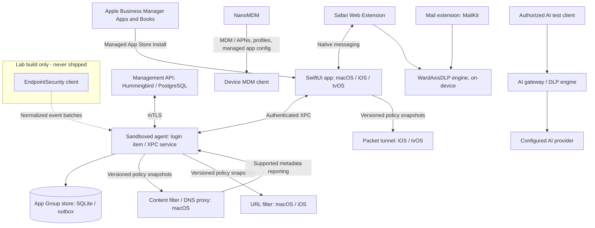

# WardAxis Endpoint — Development Roadmap

Open-source Apple-platform endpoint, network and AI data loss prevention protection for macOS, iOS/iPadOS and tvOS, distributed through the App Store. The goal is to demonstrate Apple-platform security engineering across network filtering, DLP, SWG, ZTNA, MDM and enterprise deployment. EndpointSecurity (EDR) research continues as a lab-only track that is never shipped. Build the engine first; each milestone must include tests, architecture documentation, a demonstration and measured results.

## Schedule

| Phase | Weeks | Estimated hours | Release | Plan |
|---|---|---:|---|---|
| 0. Preparation | Before week 1 | 12–18 | v0.0.1 | [Preparation](00-preparation.md) |
| 1. Network security | 1–2 | 45–60 | v0.1.0 | [Network security](01-network-security.md) |
| 2. TLS and PKI | 3–4 | 35–50 | v0.2.0 | [TLS and PKI](02-tls-pki.md) |
| 3. Secure IPC and EDR lab track | 5–6 | 40–55 | v0.3.0 | [Secure IPC and EDR lab](03-endpoint-security.md) |
| 4. AI data protection | 7–8 | 50–70 | v0.4.0 | [AI DLP, Safari and Mail](04-ai-dlp.md) |
| 5. Enterprise management | 9–10 | 45–60 | v0.5.0 | [MDM and fleet](05-enterprise-management.md) |
| 6. Production engineering | 11–12 | 35–50 | v1.0.0 | [Production engineering](06-production-engineering.md) |
| **Total** | | **262–363** | | |

Estimates assume part-time portfolio development. App Review, entitlement approval, provisioning, APNs credentials and integration debugging can extend the schedule. Every phase is independently releasable through TestFlight. Scope optional features behind the P0 acceptance gates.

## Distribution model

| Build | Channel | Contents | Signing |
|---|---|---|---|
| Shipped | App Store (Mac App Store, App Store for iOS and tvOS), TestFlight | Sandboxed app, extensions, login item | Apple Distribution, App Store provisioning |
| Lab | Internal only, never published | Shipped build plus EndpointSecurity client and lab tooling (`WARDAXIS_LAB`) | Developer ID, local test Macs only |

Every task in a phase file carries one of two labels: **Shipped** (App Store build) or **Lab-only** (never in an App Store archive). CI rejects an App Store archive that contains lab symbols or lab entitlements.

## Platform capability matrix

Source: [TN3134](https://developer.apple.com/documentation/technotes/tn3134-network-extension-provider-deployment), revision 2025-08-19. On macOS, a provider that TN3134 does not mark "App Store only" supports both App Store and Developer ID distribution.

| Capability | macOS 26 | iOS/iPadOS 26 | tvOS 26 |
|---|---|---|---|
| Content filter (NEFilterDataProvider) | System extension | Supervised or per-app managed devices only | — |
| URL filter (NEURLFilter) | App extension | App extension, no supervision required | — |
| DNS proxy | System extension | Supervised or per-app managed devices only | — |
| Transparent proxy | System extension | — | — |
| Packet tunnel | System extension | App extension | App extension (no per-app mode) |
| Safari Web Extension | Yes | Yes | — (no Safari) |
| Mail extension (MailKit) | Yes | — | — |
| Background agent | Sandboxed login item (`SMAppService.loginItem`), user consent | — | — |
| CoreML / NaturalLanguage DLP | Yes | Yes | Yes |
| Management agent (mTLS) | Yes | Yes | Yes |
| EndpointSecurity | **Lab-only** | — | — |

## App Store constraints

| Rule | Requirement | Roadmap effect |
|---|---|---|
| 2.4.5(i) | Mac apps must be sandboxed | Every shipped macOS component is sandboxed. No privileged daemon. |
| 2.4.5(ii) | Xcode packaging; single self-contained bundle; no third-party installers | No PKG. Extensions are embedded in the app bundle. |
| 2.4.5(iii) | No launch at login or background processes without consent | The login item agent starts only after explicit opt-in. |
| 2.4.5(iv) | No download of code that changes functionality | Policies and detector rules are data, not code. ML models ship in the bundle. |
| 2.4.5(v) | No root escalation or setuid | EndpointSecurity and the daemon move to the lab build. |
| 2.4.5(vii) | Updates only through the Mac App Store | No custom updater. Upgrade tests use App Store and TestFlight updates. |
| 4.4, 4.4.2 | Extensions must include functionality; Safari extensions request the minimum site access | Safari permissions are limited to registered AI and policy domains. |
| 5.1.1, 5.1.2, 2.5.14 | Privacy policy, consent, data minimization, visible indication of activity logging | Consent screen before any monitoring. Classification is on-device. Telemetry is opt-in and contains no matched content. |
| 5.4 | Apps that use NEVPNManager (packet tunnel) must come from an organization account | Organization enrollment at the start of Phase 5 (ORG-001); development before it uses an individual account. |
| 5.5 | MDM capability and configuration profiles in apps | The app does not ship MDM features or profiles. NanoMDM delivers profiles from the separate server. |

## Stack

| Layer | Technology |
|---|---|
| Language / target | Swift 6.4 toolchain (Swift 6 language mode), C interoperability, macOS 26 / iOS 26 / tvOS 26 |
| UI | SwiftUI multiplatform (focus-based navigation on tvOS) |
| Concurrency | Swift Concurrency, actors; bounded synchronous authorization paths |
| Networking | NetworkExtension (content filter, URL filter, DNS proxy, transparent proxy, packet tunnel), Network.framework |
| Runtime security | App Sandbox, code-signing checks; EndpointSecurity lab-only, not shipped |
| Cryptography | Security.framework, CryptoKit |
| IPC / services | XPC services, App Groups, NE provider messaging, `SMAppService` login item |
| Extensions | Safari Web Extension (WebExtensions + native messaging), MailKit |
| Storage | SQLite, GRDB in the App Group container |
| Backend | Hummingbird 2, PostgreSQL ([ADR 0001](../docs/adr/0001-swift-server-stack.md)) |
| Infrastructure | Docker Compose, NanoMDM (separate supported storage) |
| ML | CoreML, NaturalLanguage |
| Observability | OSLog, OSSignposter |
| Testing | Swift Testing, XCTest, JS/TS unit tests for the Safari extension |
| CI/CD | GitHub Actions, App Store Connect API |
| Distribution | App Store Connect, TestFlight, Mac App Store, Universal Purchase; Apple Business Manager managed distribution |
| Lab | Developer ID (internal, never distributed) |

## Architecture



The diagram is logical: verify provider sandbox restrictions and permitted communication channels. The shipped build never requests root; every shipped component is sandboxed. IPC uses the App Group container, NE provider messaging and XPC services. A Mach service between the app and a system extension is a candidate channel; verify it under the sandbox. The content filter data provider has restrictions on exporting network content. The synchronous authorization path never waits for IPC, storage, UI, ML, or remote connectivity. Keep policy snapshots immutable, bounded and local to each enforcement component. Treat DNS visibility, process identity, and provider availability as conditional; on iOS and tvOS, flow attribution is limited. TLS inspection is restricted to the isolated, owned test laboratory; the AI gateway receives content only from explicitly integrated clients. Simulated, lab and genuine App Store build results must be labeled separately.

## Repository layout

```text
WardAxisEndpoint/
├── Applications/WardAxis/          # Multiplatform app: macOS, iOS, tvOS
├── Extensions/
│   ├── NetworkFilter/              # macOS system extension
│   ├── TransparentProxy/           # macOS system extension
│   ├── DNSProxy/                   # macOS system extension
│   ├── URLFilter/                  # macOS and iOS app extension
│   ├── PacketTunnel/               # iOS and tvOS app extension
│   ├── SafariWebExtension/         # macOS and iOS
│   └── MailExtension/              # macOS MailKit
├── Services/
│   └── Agent/                      # macOS sandboxed login item
├── Packages/
│   ├── WardAxisCore/
│   ├── WardAxisPolicy/
│   ├── WardAxisIPC/
│   ├── WardAxisStorage/
│   ├── WardAxisTelemetry/
│   ├── WardAxisNetworking/
│   ├── WardAxisPKI/
│   ├── WardAxisProcess/
│   ├── WardAxisDLP/
│   ├── WardAxisManagement/
│   └── WardAxisManagementAPI/      # OpenAPI contract shared by the agent and the server
├── Lab/                            # Excluded from App Store schemes
│   ├── EndpointSecurity/
│   └── Schemes/
├── Tools/
│   ├── WardAxisCLI/
│   └── BenchmarkRunner/
├── Server/ManagementServer/
├── Infrastructure/
│   ├── Docker/
│   ├── NanoMDM/
│   └── PKI/
├── Configuration/
│   ├── Entitlements/               # Per target and per platform
│   ├── Profiles/
│   └── Policies/
├── AppStore/                       # Listing, screenshots, privacy, review notes
├── Tests/
│   ├── Integration/
│   ├── Performance/
│   ├── Security/
│   └── Fixtures/
├── Documentation/
│   ├── Architecture/
│   ├── ADR/
│   ├── ThreatModel/
│   ├── Deployment/
│   └── Benchmarks/
└── .github/workflows/
```

## Shared package requirements

`WardAxisCore` contains Sendable domain models and protocols. Policy, storage and telemetry depend on core. Networking, PKI, process, DLP, management and IPC compose these layers as needed. Executable targets depend on packages; packages never depend on executable targets. Keep framework adapters separate from pure policy logic. Use dependency injection for clocks, event sources, identity resolution, storage and transport. Every package builds for macOS, iOS and tvOS; platform-specific adapters use `#if os(...)` at the adapter boundary only. Lab-only code compiles only under `WARDAXIS_LAB`.

## Architecture decision records

Each ADR contains context, alternatives, decision, consequences and validation criteria ([template](../docs/adr/TEMPLATE.md)). Records in `docs/adr/` use the next free repository number; the Record column maps a roadmap ID to its file. The threat model is [docs/THREAT-MODEL.md](../docs/THREAT-MODEL.md).

| ID | Decision | Record |
|---|---|---|
| ADR-001 | System and app extensions under App Store distribution | [0008](../docs/adr/0008-extensions-under-app-store.md) |
| ADR-002 | Network filtering versus transparent proxying | — |
| ADR-003 | Immutable security policy snapshots | — |
| ADR-004 | Swift 6 concurrency and C interoperability | — |
| ADR-005 | EndpointSecurity as a lab-only track | [0009](../docs/adr/0009-endpoint-security-lab-only.md) |
| ADR-006 | Sandboxed IPC (XPC, App Groups, NE messaging) | — |
| ADR-007 | SQLite and bounded event persistence | — |
| ADR-008 | Certificate trust and private PKI | — |
| ADR-009 | DLP detection architecture | — |
| ADR-010 | NanoMDM versus custom MDM implementation | — |
| ADR-011 | Signed policy distribution | — |
| ADR-012 | Fail-open and fail-closed semantics | — |
| ADR-013 | Privacy-preserving telemetry | — |
| ADR-014 | App Store install, update and removal | — |
| ADR-015 | App Store–only distribution and platform matrix | [0010](../docs/adr/0010-app-store-only-distribution.md) |
| ADR-016 | Safari Web Extension DLP | — |
| ADR-017 | MailKit compose DLP | — |
| ADR-018 | tvOS packet-tunnel filtering | — |
| ADR-019 | URL filter versus content filter per platform | — |

## Testing strategy

| Component | Initial coverage target |
|---|---:|
| Policy engine | 95% |
| PKI and trust evaluation | 90% |
| DLP classifiers | 90% |
| Event normalization | 85% |
| Secure IPC validation | 90% |
| Management API | 85% |
| Storage | 85% |
| Safari extension (JS/TS) | 85% |
| Mail extension handlers | 85% |
| SwiftUI | 60% |

Prioritize branch coverage, negative cases, property-based tests, integration tests and bounded failure behavior over aggregate line coverage. Unit tests execute without special entitlements on macOS and on the iOS and tvOS simulators. Integration tests run on dedicated devices. Report hardware, OS, workload, measurement methods, limitations and actual results separately from targets.

## Project tracking

Use releases above as milestones and task IDs in each phase as GitHub issues. Suggested labels: `P0`, `P1`, `P2`, `security`, `network-extension`, `endpoint-security`, `pki`, `mdm`, `dlp`, `performance`, `testing`, `documentation`, `architecture`, `blocked-entitlement`, `app-store`, `macos`, `ios`, `tvos`, `safari-extension`, `mail-extension`, `lab-only`.

## Career mapping

| Role | P1 | P2 | P3 | P4 | P5 | P6 |
|---|---|---|---|---|---|---|
| macOS Network Security Engineer | High | High | Medium | Medium | Medium | High |
| macOS EDR Engineer | Medium | Medium | High | Low | High | High |
| Senior macOS Systems Engineer | High | Medium | High | Low | High | High |
| Apple Platforms Security Engineer | High | High | Medium | High | High | High |
| Enterprise AI Security Engineer | High | High | Medium | High | High | Medium |
| DLP Engineer | High | High | Medium | High | High | Medium |
| MDM Engineer | Medium | Medium | Medium | Low | High | High |
| Security Software Architect | High | High | High | High | High | High |

Start applying after phase 2. Use concrete artifacts and measured results to demonstrate skills; distinguish personal laboratory work from production fleet experience. EDR roles are supported by lab-build evidence, not by the shipped product.

## Technical references

- [App Review Guidelines](https://developer.apple.com/app-store/review/guidelines/)
- [NetworkExtension](https://developer.apple.com/documentation/networkextension)
- [TN3134: Network Extension provider deployment](https://developer.apple.com/documentation/technotes/tn3134-network-extension-provider-deployment)
- [URL filters](https://developer.apple.com/documentation/networkextension/url-filters)
- [NETransparentProxyProvider](https://developer.apple.com/documentation/networkextension/netransparentproxyprovider)
- [App Sandbox](https://developer.apple.com/documentation/security/app-sandbox)
- [Privacy manifest files](https://developer.apple.com/documentation/bundleresources/privacy-manifest-files)
- [Safari web extensions](https://developer.apple.com/documentation/safariservices/safari-web-extensions)
- [MailKit](https://developer.apple.com/documentation/mailkit)
- [Security framework](https://developer.apple.com/documentation/security)
- [Swift Certificates](https://github.com/apple/swift-certificates)
- [SwiftNIO SSL](https://github.com/apple/swift-nio-ssl)
- [EndpointSecurity](https://developer.apple.com/documentation/endpointsecurity) (lab track)
- [System Extensions / entitlement requests](https://developer.apple.com/system-extensions/)
- [ServiceManagement](https://developer.apple.com/documentation/servicemanagement)
- [XPC](https://developer.apple.com/documentation/xpc)
- [MITRE ATT&CK macOS](https://attack.mitre.org/matrices/enterprise/macos/)
- [CoreML](https://developer.apple.com/documentation/coreml)
- [NaturalLanguage](https://developer.apple.com/documentation/naturallanguage)
- [NanoMDM](https://github.com/micromdm/nanomdm)
- [NanoMDM quickstart](https://github.com/micromdm/nanomdm/blob/main/docs/quickstart.md)
- [Apple Device Management](https://developer.apple.com/documentation/devicemanagement)
- [Apple device management schemas](https://github.com/apple/device-management)
- [Apple Business Manager](https://support.apple.com/guide/apple-business-manager/welcome/web)
- [App Store Connect API](https://developer.apple.com/documentation/appstoreconnectapi)
- [Apple Platform Security](https://support.apple.com/guide/security/welcome/web)

## Open-source reference projects

- [LuLu](https://github.com/objective-see/LuLu) — firewall architecture.
- [BlockBlock](https://github.com/objective-see/BlockBlock) — persistence monitoring (lab track).
- [ProcessMonitor](https://github.com/objective-see/ProcessMonitor) — process events (lab track).
- [Santa](https://github.com/northpolesec/santa) — binary authorization and policy (lab track).
- [osquery](https://github.com/osquery/osquery) — telemetry and device posture.
- [mitmproxy](https://github.com/mitmproxy/mitmproxy) — proxy protocol research in the laboratory.
- [MicroMDM](https://github.com/micromdm/micromdm) and [NanoMDM](https://github.com/micromdm/nanomdm) — MDM infrastructure.
- [Fleet](https://github.com/fleetdm/fleet) — enterprise endpoint management.
